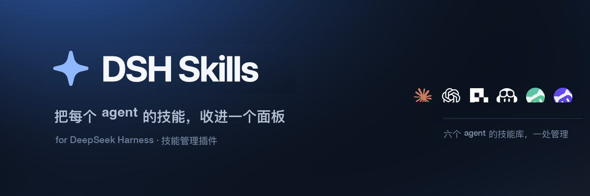

# dsh-skill-manager

English | [中文](README.zh.md)



A **技能 / Skills** row in the DeepSeek Harness left navigation, and the page it opens.

[Install](#install) · [Download v0.2.0](https://github.com/yixin2021/dsh-skill-manager/releases/latest) ·
[Landing page](https://yixin2021.github.io/dsh-skill-manager/) (`github.io` is unreachable on some networks — see below)

DSH discovers Agent Skills from `.dsh/skills` and `.agents/skills` — under your
home and under a project — but ships no surface for seeing what is installed or
for turning one off without editing files. This plugin adds that surface.

## What the panel does

| | |
|---|---|
| **See everything** | Every root DSH scans, with each skill's name, description, instruction path and invocation policy. |
| **Preview** | The full `SKILL.md`, frontmatter and body, without leaving the app. |
| **Enable / disable** | A switch per skill. Disabled skills keep their bytes and stay on disk. |
| **Install** | Copy a folder that has `SKILL.md` at its top level into the root you pick. The original is never moved. |
| **Import from GitHub** | Paste a GitHub repository, tree, or skill link. One repository can contribute several skills in one batch; conflicts and oversized bundles reject the whole batch without overwriting. |
| **New skill** | Write a bundle with a valid frontmatter block from a form. |
| **Uninstall safely** | Uninstall moves the entry to a root-local `.trash`; restore it later, or delete it for good. |
| **Locate** | Reveal a skill or a root in Finder / Explorer / the desktop file manager. |
| **Known libraries** | Codex, Claude Code, Pi, GitHub Copilot, WorkBuddy and CodeBuddy keep their skills in well-known places; those that exist are listed automatically, each with that agent's mark. An agent that is installed but has no skill yet is listed too, so its first skill has a target. |
| **Claude Code, Pi and Copilot skills** | Claude Code's user library (`~/.claude/skills`), Pi's (`~/.pi/agent/skills`) and GitHub Copilot's (`~/.copilot/skills`), plus each repository's own `.claude/skills`, `.pi/skills` and `.github/skills`, are listed, switched, installed into and loaded by DSH. |
| **Skill market** | A second tab browses a curated catalogue shipped with the package (`docs/skills.json`) and published indexes, and installs a skill with one click. Its toolbar manages **custom index sources**, so any GitHub repository or JSON index can feed the same cards; each card's **View source** opens that skill's own folder. Browsing is offline-first; installing reuses the same remote path as a pasted link. |
| **Add a directory** | Point the panel at another agent's skill library — `~/.claude/skills`, a colleague's checkout, a shared bundle. Its skills are listed, managed in place, and loaded by DSH too. |

## Install

**From GitHub.** This repository is a ready-to-install package: `package.json`
sits at the root and there is no build step, so any npm-compatible git spec
resolves. In the plugin manager (Settings → Plugins), install:

```
github:yixin2021/dsh-skill-manager
```

The same spec works from the CLI — `dsh plugin` forwards its arguments to pnpm
inside the profile:

```sh
dsh plugin --profile desktop add github:yixin2021/dsh-skill-manager
dsh plugin --profile desktop remove dsh-skill-manager
```

`https://github.com/yixin2021/dsh-skill-manager` and
`git+ssh://git@github.com/yixin2021/dsh-skill-manager.git` are equivalent.

**From a local checkout.**

```sh
dsh plugin --profile desktop add /absolute/path/to/dsh-skill-manager
```

The bundle patch inserts one Loader row named `skills`; the client half mounts
the navigation row and the panel. Reload the window after installing.

## How it works

**Host half** (`index.js`) registers one authenticated JSON route,
`POST /api/dsh-skill-manager`, on `ctx.connection.fetch`. It answers `list`, `read`,
`set-disabled`, `trash`, `restore`, `purge`, `empty-trash`, `create`,
`import-directory`, `import-files`, `install-from-remote`, `reveal`, `add-root`
and `remove-root`. `ctx.skills.registerProvider` publishes the
discovered libraries and the added directories to the model. `lib/skills-core.js` owns the
skill grammar — frontmatter parsing, root discovery, entry scanning — so the
route and the tests agree on what a skill is.

**Client half** (`client.js`) registers a `sidebar.panellist` icon under the id
`dsh-skill-manager` and the `main` panel keyed by that same id, which is how the layout
addresses a panel. It never reads a skill root itself: every fact arrives
through the route, so the browser has no filesystem authority.

### Importing from GitHub

A skill that lives in a GitHub repository is one directory bundle: `<dir>/SKILL.md`
plus whatever it references. Paste a GitHub link and the panel reads the archive,
shows the skills it finds, and lets you select one or several for a single import.
The Host validates every selected bundle before writing any of them: an existing
name, an invalid path, or a size/file-count limit rejects the whole batch without
overwriting or leaving a partial install.

| Link | How it is read |
|---|---|
| `https://github.com/owner/repo` | The archive service — one request, no rate limit. |
| `https://github.com/owner/repo/tree/main/skills/foo` | The same, narrowed to that directory. |
| `https://gitlab.com/owner/repo/-/tree/main/skills/foo` | Cloned, then narrowed. |
| `https://gitee.com/owner/repo/tree/main/skills/foo` | Cloned, then narrowed. |
| `git@host:owner/repo.git` | Cloned over SSH. |
| `https://host/owner/repo.git#branch` | Cloned at that branch. |

GitHub has an archive endpoint that answers with the whole tree in one request
and no rate limit, so it is read that way; every other git host is cloned,
shallowly, into a temporary directory that is deleted as soon as the tree has
been read. Both paths end in the same tree, and `lib/skill-tree.js` owns the
policy both obey: which directory holds a `SKILL.md`, which files belong to it,
and which paths may become a file name.

A repository that holds several skills is a catalogue. The dialog shows checkboxes,
starts with all visible candidates selected, and supports selecting or clearing
all. If more than 40 candidates are found, the dialog reports the total and
suggests narrowing the GitHub link to a subdirectory. A branch whose name
contains a slash (`release/2.0`) is resolved by trying the possible branch/path
splits until the requested directory is found.

**A private repository** needs an access token. The dialog has a field for one,
and it is optional: a public repository never carries a token, so none is sent.
The token is used for that one download and is never written to disk. For a git
clone it travels in the child's environment rather than in the command line,
where every process on the machine could read it.

**The transport is restricted.** `git` understands transports beyond HTTP and
SSH, and some of them run commands — `ext::` executes a shell command, and
`file://` reads the machine's own disk. A pasted link must never reach either,
so the URL is checked against an allowlist (`https`, `http`, `ssh`, `git`) before
`git` sees it, a local path is refused as "not a remote repository", and
`GIT_ALLOW_PROTOCOL` narrows it again inside the child process. The clone is
also told not to prompt: a credential prompt in a background panel is a hang
nobody can answer.

Nothing inside a repository is executed. The archive is unpacked in memory,
the clone is read as files, symlinks are skipped rather than followed, and
every path is resegmented before it becomes a file name.

### Disabling without deleting

DSH only discovers *direct children* of a skill root. A disabled skill is moved
to `<root>/.disabled/<name>` — hidden, therefore invisible to every provider —
and moved back untouched when re-enabled. Nothing in `SKILL.md` is rewritten,
so a hand-written skill survives a round trip byte for byte. The same trick
backs `.trash`.

### Known agent libraries

Six libraries are found on their own, so a machine that already runs another
coding agent needs no configuration. This is the order the page lists them in:

| Mark | Library | Path |
|---|---|---|
| DeepSeek | DeepSeek Harness | `$DSH_HOME/skills` (usually `~/.dsh/skills`) |
| DeepSeek | Agents | `$DSH_AGENTS_HOME/skills` (usually `~/.agents/skills`) |
| Codex | Codex | `$CODEX_HOME/skills` (usually `~/.codex/skills`) |
| Claude Code | Claude Code | `$CLAUDE_CONFIG_DIR/skills` (usually `~/.claude/skills`) |
| Pi | Pi | `$PI_CODING_AGENT_DIR/skills` (usually `~/.pi/agent/skills`) |
| GitHub Copilot | GitHub Copilot | `$COPILOT_HOME/skills` (usually `~/.copilot/skills`) |
| WorkBuddy | WorkBuddy | `$WORKBUDDY_HOME/skills` (usually `~/.workbuddy/skills`) |
| CodeBuddy | CodeBuddy | `$CODEBUDDY_HOME/skills` (usually `~/.codebuddy/skills`) |

Discovery runs on every read rather than being remembered, so installing
another agent later just works, and deleting a library removes it from the
list. A library that does not exist yet is still listed while its agent is
installed — Claude Code with a `~/.claude/settings.json` but no `skills/`
folder, for instance — and shows "not created yet" instead of disappearing:
that is exactly the state in which someone wants to give that agent its first
skill, and the install and import actions create the folder as they write.
Removing the agent's own home removes the row.

They are managed like DSH's own roots: the plugin is the provider that
hands them to the model, so the switch changes the catalog the next step reads.
The bytes still belong to that agent, and uninstalling only moves them into that
library's own `.trash`, where they can be restored.

Pi is the one agent whose library is not directly inside its home: the agent
directory is `~/.pi/agent` (moved by `PI_CODING_AGENT_DIR`), because `~/.pi`
also holds the package cache and the shared session store. A `~/.pi` without an
`agent/` subdirectory is therefore not evidence that Pi is installed, and the
row does not appear.

The marks are the vendors' own, taken from published brand assets rather than
drawn here: the DeepSeek whale (`deepseek.svg` from simple-icons), the OpenAI
knot and the Claude asterisk (`openai.svg`, `claude.svg` from
`@lobehub/icons-static-svg`), Pi's three-shape glyph (`favicon.svg` from
pi.dev), GitHub Copilot's helmet (`copilot-24.svg` from the official Primer
octicons), and the official `logo.svg` tiles served by codebuddy.ai and
workbuddy.cn. The monochrome ones inherit `currentColor` so they follow the
theme; the two tiles keep their own gradients. Brand marks belong to their
owners and identify the directory the skills came from.

### Claude Code, Pi and Copilot, in both scopes

These agents read skills from two places, and all six directories are managed
here:

| Agent | Scope | Path | Root key |
|---|---|---|---|
| Claude Code | User | `$CLAUDE_CONFIG_DIR/skills` (usually `~/.claude/skills`) | `agent:claude` |
| Claude Code | Repository | `<workspace>/.claude/skills` | `project-claude:<workspace path>` |
| Pi | User | `$PI_CODING_AGENT_DIR/skills` (usually `~/.pi/agent/skills`) | `agent:pi` |
| Pi | Repository | `<workspace>/.pi/skills` | `project-pi:<workspace path>` |
| GitHub Copilot | User | `$COPILOT_HOME/skills` (usually `~/.copilot/skills`) | `agent:copilot` |
| GitHub Copilot | Repository | `<workspace>/.github/skills` | `project-copilot:<workspace path>` |

The repository scope is listed per open workspace, and only when the directory
exists — a repository that has never carried that agent's skills gains no empty
row. Because DSH scans none of `.claude`, `.pi` or `.github`, the plugin serves
these directories through its own provider, so disabling a skill there really
removes it from the model catalog rather than merely hiding it in the panel.
Project rows name the folder they come from (`repo · .pi/skills`), since one
workspace can hold `.dsh/skills`, `.agents/skills`, `.claude/skills`,
`.pi/skills` and `.github/skills` at once.

Copilot also reads `.claude/skills`, `.agents/skills` and `~/.agents/skills`.
Those directories are already listed under their own rows, so Copilot's rows
stay at `.github/skills` and `~/.copilot/skills` rather than duplicating them.

### Skill market

The page has two tabs. **My skills** is everything on disk; **Market** is a
short, curated list a person can install with one click.

The market merges two things:

1. **The bundled catalogue** `docs/skills.json`, shipped inside the package.
   Offline, always present.
2. **Index sources** — each is a JSON document listing GitHub repositories; the
   Host reads each repository's git tree once and turns every `SKILL.md` it
   finds into one installable card. The bundled index ships as
   `docs/market-index.json` and covers `anthropics/skills`, `wshobson/agents`
   and `anthropics/claude-cookbooks`; it is fetched through the GitHub contents
   API (with a raw fallback), because some networks reset
   `raw.githubusercontent.com` while the API answers. Beyond that, anyone can
   press **Index sources** on the market tab and add their own (see below).

A source that is down only adds a collapsible warning; the bundled file and the
rest of the panel keep working offline. Fetched indexes are cached for ten
minutes. A card's **View source** link opens that skill's own folder, not the
repository root.

The bundled file is (the optional `view` is the page the card opens; installing
still reads `source` and `path`):

```json
{
  "schema": 1,
  "skills": [
    {
      "id": "skill-creator",
      "name": "Skill Creator",
      "description": "Anthropic's guide and templates for authoring and packaging Agent Skills …",
      "author": "Anthropic",
      "tags": ["skills", "docs"],
      "source": "https://github.com/anthropics/skills",
      "path": "skills/skill-creator",
      "view": "https://github.com/anthropics/skills/tree/HEAD/skills/skill-creator"
    }
  ]
}
```

Every entry is validated on read. A malformed row is dropped, and a `source`
whose host is not one the installer already reads (`github.com`, `gitlab.com`,
`gitee.com`, `gitcode.com`, `atomgit.com`) is refused — the market can never
widen where the panel will fetch from. Installing an entry is an ordinary
`install-from-remote` request for its `source` into the library you are viewing,
so the same size limits, conflicts and "choose a skill" step apply as for a
pasted link.

#### Custom index sources

The market toolbar carries an **Index sources** button. Its dialog lists every
source in use — the built-in one is tagged **Built-in** and cannot be removed —
and accepts one link at a time:

- **A repository link** `https://github.com/owner/repo` turns every `SKILL.md`
  in it into a card;
- **A JSON file inside a repository** — a page link such as
  `https://github.com/owner/repo/blob/main/docs/index.json` is rewritten to the
  GitHub API read;
- **A plain JSON URL** — any publicly reachable `https://…/index.json`;
- **A GitLab, Gitee, GitCode or AtomGit `blob` page** is rewritten to that host's
  `raw` route.

Nothing is fetched when a link is added, so an index that is temporarily down
can still be stored while a typo is fixed; the market is reread afterwards and a
dead source only adds a warning. The list lives in
`$DSH_HOME/skills-market-sources.json` — beside the skill roots, a fact about
this machine rather than a profile — with at most 20 sources, and a malformed
row is dropped. To keep the Host from being aimed inward, `localhost`, `127.*`,
`10.*`, `192.168.*`, `169.254.*`, `172.16`–`172.31`, `*.local` and `*.internal`
hosts are refused.

> Published indexes are read through the GitHub API. The anonymous limit is
> 60 requests per hour per IP and one market read costs one request per
> repository; if 403 / rate-limit warnings become common, export
> `GITHUB_TOKEN` or `GH_TOKEN` where DSH starts to use the authenticated
> budget. The token is only sent to `api.github.com`, never to another index
> host.

### Added directories

DSH scans four roots and no others, so the plugin registers its own skill
provider (`ctx.skills.registerProvider`) that serves the added directories with
`source: 'custom'` — the label DSH reserves for exactly this. The model sees
those skills in its catalog, with the invocation policy from each frontmatter,
and a symlinked bundle counts as a skill (Claude Code and stow both link rather
than copy). Adding or removing a directory, or switching a skill in any root,
invalidates the catalog, so the next model step sees the change without a
restart.

The directories are **managed, not just browsed**: enable/disable, uninstall
and restore, create, and install targets all work there, because this plugin —
not DSH — is what hands those skills to the model. That is also the limit of
the claim: disabling renames a bundle into `<root>/.disabled` and uninstalling
moves it into `<root>/.trash`, both reversible and both confined to that root.
"Install…" still copies a skill into another root, which is how a skill in
someone else's library becomes DSH's own bytes.

The list lives in `$DSH_HOME/skills-roots.json` — beside the skills rather than
inside a profile, so it survives a profile rebuild and is shared by the web and
desktop apps. A malformed file is read as an empty list; adding a directory
rewrites it. Keys are hashed from the path, so removing one directory never
re-points another's filter.

### Scoping

All writes go through `resolveWithin`, which refuses a path that leaves its
root. Skill names match `^[A-Za-z0-9][A-Za-z0-9._-]{0,63}$`; a requested entry
must already exist where the request claims it does; a create or install
refuses to overwrite an existing enabled, disabled or trashed entry. A remote
import obeys the same rules: its paths are resegmented before they become file
names, and a symlink inside a repository is skipped rather than followed.

## UI conventions

- Only Host theme tokens (`--dsw-alias-*`) are used — no hard-coded palette, so
  light and dark themes both work.
- Every visible string goes through `ctx.locale.register` / `ctx.locale.bind`
  with a `zh` and an `en` dictionary; the row's label is a locale-aware
  function, not a captured string.
- `React` here is the shell's curated object, which exposes only
  `createElement`, `useState` and `useEffect`. The panel uses exactly those
  three: anything else — `useSyncExternalStore`, `useRef`, `memo` — is
  `undefined` and throws at render, which blanks the panel.
- No Harness Client package is imported. Every control is a plain element
  styled from tokens, so the panel cannot break on a missing primitive module
  or an invented prop name.
- Dialogs are announced as `role="dialog"` / `aria-modal`, close on Escape and
  on a backdrop click, and the enable/disable control is a real checkbox with
  an accessible name.
- No DOM outside the panel is touched, and nothing is appended to
  `document.body` except the transient folder-picker input, which is removed
  as soon as the picker closes.

## Tests

```sh
npm test
```

Runs `node --check` on all nine sources, then 147 tests over a real temporary
tree and over fixtures built in the test itself: frontmatter parsing (quoted
scalars, comments, block scalars, invalid flag spellings), path containment,
root discovery, direct-children-only scanning, and every mutation including
the refusals — plus the remote path: link parsing, the transport allowlist, the
tar reader, and the clone.

## Known limits

- Binaries are not carried by `import-files`, since the route transports text;
  use `import-directory` or copy assets into the bundle afterwards.
- Added directories reach the model through this plugin, not through DSH. If a
  composition has no `skills` service the panel still works, but those skills
  never enter the model's catalog.
- Installing a skill out of an added directory leaves two copies on disk; the
  original is never moved.
- The panel shows what a root holds now; it does not watch the filesystem, so
  use the reload control after editing files on disk.
- A remote import needs either `git` on the machine (for every host but
  GitHub) or a link to a GitHub repository.
- A repository is read whole; a very large one costs one download or one
  shallow clone, and archives beyond 24 MB are refused rather than downloaded.
